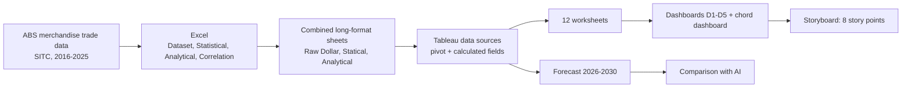

# Australia's Goods Trade 2016-2025: From Ten Main Categories to Petroleum

Interactive Tableau and Excel analysis of Australia's goods trade (ABS, 2016–2025), moving from ten SITC main categories down to Petroleum through dashboards, a storyboard and a 2026–2030 forecast.
Key finding: the trade surplus peaked at A$176.9B in 2022, while Petroleum imports were 3.7× exports in 2025 (A$52.7B vs A$14.2B), which points to fuel-supply security and price-shock planning.

Techniques used: YoY and share patterns in Excel · correlation matrix · wide-to-long pivoting · calculated fields · cross-source highlight and filter actions · Sankey and chord diagrams · exponential-smoothing forecast

## Key findings
## Finding	Evidence
1	Trade grew, but the surplus has narrowed since 2022	Exports A$258.5B → A$523.1B (CAGR 8.1%); imports A$254.3B → A$460.9B (6.8%); surplus peaked at A$176.9B in 2022 and was A$62.2B in 2025
2	Exports are concentrated, imports are led by one group	Crude materials and Mineral fuels = 61% of 2025 exports; Machinery and transport equipment = 41% of imports
3	Mineral fuels drives the major change points	Exports -30% in 2020, +99% in 2022 (92% of that year's export growth), -44% from the peak by 2025
4	A few sub-categories explain each main category	Metalliferous ores are 90% of Crude materials exports; Gold is 90% of group 9 exports; Petroleum is 99% of Mineral fuels imports
5	The mix inside Mineral fuels exports is shifting	Gas rose from 27% to 44% of the group while Coal fell from 62% to 46% (2016 → 2025)
6	Petroleum is an import-dependence risk	Imports A$52.7B vs exports A$14.2B in 2025; cumulative ten-year deficit A$301.3B
7	Model and AI disagree on direction	Tableau projects a rise (exports ≈ A$16.6B → A$19.5B, imports ≈ A$62B → A$75B); the AI projects a decline (≈ A$12B and A$45B by 2030). The outcome likely lies between the two

## Storyboard
1. Overview:	Raw dollar values, year-on-year ratios, trade balance and shares for the ten main categories

2. Export:	Correlation of YoY changes between main categories and the Sankey flow of each year's exports

3. Import:	Same views for imports

4. Export and Import by group:	Chord diagram of cumulative flows 2016–2025	Chord

5. Main to Sub: Export	Treemap of sub-categories with linked value and share charts	Main to Sub: Export

6. Main to Sub: Import	Same drill-down for imports	Main to Sub: Import

7. Petroleum focused: Sub	Export vs import, 2026–2030 forecast, comparison with Coal and Gas	Petroleum

8. Summary and Recommendations	Findings and four recommendations


## Techniques highlighted
### Excel: Statistical and analytical patterns

| Technique | How it was done | Why it matters |
|---|---|---|
| **Share patterns** (statistical) | Main category ÷ TOTAL (`=B4/$CA4`); sub-category ÷ its main category (`=C4/$B4`) | Shows composition and concentration, not just size |
| **Year-on-year ratio** (analytical) | Value this year ÷ value last year; 2016 = 1 | Makes growth comparable across categories of very different size and exposes change points |
| **Correlation matrix** | `CORREL` with `INDEX`/`MATCH` on the YoY ratios, 2017–2025 (n = 9) | Relationships between categories; YoY ratios are used because raw dollars all trend upward and would correlate by construction |
| **Significance threshold** | With n = 9, \|r\| ≳ 0.67 is needed at the 5% level; weaker values treated as inconclusive | Avoids over-reading a short series |
| **Long-format consolidation** | Export and Import stacked into one table with a `Trade` column | Tableau-ready data with one filter for both flows |
| **Data-quality handling** | Fixed a Trade label typo; documented three #DIV/0! cells where the previous year is zero | Transparent about undefined growth rates |

### Tableau: data preparation and calculations

| Technique | How it was done | Why it matters |
|---|---|---|
| **Pivot wide → long** | Category columns pivoted into one dimension and one measure | Enables time-series, colour and filter by category |
| **Calculated fields** | `Year` (`MAKEDATE`), `Code`, `Level` (Main / Sub / Total), `Label`, `Parent`, `Trade Balance` | Separates main from sub-categories to avoid double counting and links the two levels |
| **Separate data sources per sheet** | One source each for raw dollars, YoY, shares and correlation | Related tables shared column names and made the Value field ambiguous; separate sources fixed it |
| **Matching field names across sources** | The same `Label`, `Year`, `Parent`, `Trade` fields were created in each source | Required for actions to work across sources |
| **Quick table calculation** | `Percent Difference` relative to 2016 | Puts Coal, Petroleum and Gas on one scale |

## Data flow



## Repository structure
```
.
├── README.md
├── data/                 # source Excel workbook (check ABS licence terms before sharing raw data)
├── excel/                # statistical, analytical and correlation sheets
├── tableau/              # .twbx workbook (packaged)
├── docs/
│   └── storyboard/       # screenshots used in this README

```

## How to open
1. Open the packaged workbook (`.twbx`) in Tableau Desktop.
2. The Sankey and chord diagrams use Tableau extensions and need an internet connection; the free ShowMeMore version does not render for viewers of published dashboards, so static screenshots are provided in `docs/storyboard/`.
3. On the story, use the story-point tabs; on dashboards, hover or click categories to trigger highlight and filter actions.

## Data and limitations
- **Source:** Australian Bureau of Statistics, International Trade in Goods and Services (merchandise trade by SITC); 10 main categories and 67 sub-categories, annual, A$ million.
- Values are **nominal** (not adjusted for inflation or exchange rates), so price effects are mixed with volume.
- Ten annual observations are a short series: forecasts and correlations (nine YoY changes) are indicative.
- Group 9 and SITC 98 contain confidential and unclassified items.
